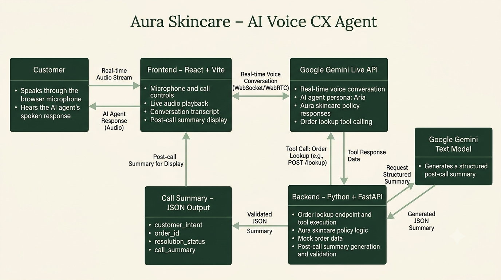

# Aura Skincare AI Voice Agent

## Project overview

Aura Skincare AI Voice Agent is a browser-based customer-support demo for the DATASTRAW AI Voice CX Agent assessment. Customers can speak with Aria, an AI support assistant, about a small set of fictional sample orders and the configured Aura Skincare policies.

The project combines a React/Vite interface, a FastAPI backend, and the Gemini Live API for realtime voice conversation. Order and policy facts come from deterministic backend data and helpers rather than being invented by the model.

## Features

- Browser-based voice calls with microphone input and streamed audio responses from Gemini Live (`gemini-3.8-live`).
- Read-only Gemini tool calls for order details, the sample-order list, shipping fees, COD eligibility, payment-status availability, cancellation eligibility, and return eligibility.
- Backend-owned mock order and policy data used as the source of truth for tool responses.
- Listening, thinking, speaking, connection, and error status indicators.
- Live customer/assistant transcript based on Gemini transcription events, grouped by conversational turn.
- Post-call JSON summary with schema validation, generated with `gemini-3.5-flash-lite`.
- Sample-order table in the browser.
- Clear handling for unknown order IDs and missing payment-status data.
- Cancellation and return tools report eligibility only; they do not cancel an order, process a return, approve a refund, or issue a replacement.
- Sample-order listing provides a general overview and does not identify an order as belonging to the caller.

## Technology stack

| Component | Technology | Purpose |
|---|---|---|
| Frontend | React 18, JavaScript, Vite 8 | Browser UI, microphone capture, transcript and call controls |
| Browser audio | Web Audio API and AudioWorklet | Capture/resample microphone audio and schedule streamed PCM playback |
| Backend | Python, FastAPI, Uvicorn | HTTP APIs, WebSocket proxy, deterministic tools, and summary route |
| Gemini SDK | `google-genai` | Gemini Live voice session, tool calls, and text summary generation |
| Configuration | `python-dotenv` | Read the backend API key from `backend/.env` |
| Validation | Pydantic | Validate transcript entries and post-call summary data |
| Tests | Python `unittest`, Node.js built-in test runner | Backend unit/API tests and frontend audio-queue tests |

Dependency versions are not pinned in `backend/requirements.txt`; the frontend versions and lockfile are defined in `frontend/package.json` and `frontend/package-lock.json`.

## Architecture and engineering decisions

The application separates real-time voice interaction, backend business logic, and post-call summary generation.



*Figure 1: High-level architecture of the Aura Skincare AI Voice Agent.*

- Keep API credentials and Gemini SDK calls in the backend rather than exposing credentials to the browser.
- Use model tool calls for conversational routing, but deterministic Python functions and mock data for order and policy facts.
- Stream microphone audio and assistant audio through one backend WebSocket so the key and tool execution remain backend-side.
- Keep transcript/tool context in memory for the call and discard it after a successful summary. Context also expires after one hour; there is no persistent call database.
- Validate summary input/output with Pydantic and return structured JSON. Summary-generation errors are surfaced to the frontend, while the transcript remains available.
- Use mocked model interactions for ordinary backend tests so the suite does not depend on a live API request.

This is an assessment/demo implementation, not a production support platform.


## Project structure

```text
aura-voice-agent/
├── backend/
│   ├── .env.example
│   ├── assistant_tools.py
│   ├── call_summary.py
│   ├── main.py
│   ├── orders.py
│   ├── policies.py
│   ├── requirements.txt
│   ├── tests/
│   │   ├── test_assistant_tools.py
│   │   ├── test_backend.py
│   │   └── test_call_summary.py
│   ├── test_gemini.py
│   └── test_gemini_live.py
├── frontend/
│   ├── package.json
│   ├── package-lock.json
│   ├── public/
│   │   └── mic-processor.js
│   ├── src/
│   │   ├── App.css
│   │   ├── App.jsx
│   │   ├── audioPlaybackQueue.js
│   │   └── main.jsx
│   └── tests/
│       └── audioPlaybackQueue.test.js
├── .gitignore
└── README.md
```

Virtual environments, `.env`, `node_modules`, Python caches, and generated build output are intentionally omitted.

## Prerequisites

- Python 3.10 or newer. The source uses Python's `X | None` type-union syntax, introduced in Python 3.10.
- Node.js 20.19+ or 22.12+, as required by the installed Vite 8 package.
- npm, included with Node.js.
- A Gemini API key with access to the configured Gemini models for Live calls and non-empty call summaries.
- A modern browser with microphone and Web Audio API support. Microphone access requires HTTPS or localhost.

No specific compatible Python upper bound or runtime test matrix is declared by the repository.

## Environment configuration

The backend reads one environment setting from the file `backend/.env`:

| Variable | Location | Required for |
|---|---|---|
| `GEMINI_API_KEY` | `backend/.env` | Gemini Live calls and non-empty post-call summaries; also used by the standalone Gemini test scripts |

Create a local backend environment file from the safe template:

```powershell
Copy-Item backend\.env.example backend\.env
```

Then edit `backend\.env` and replace the placeholder with your own key. The application reads this file directly; no shell environment export is required. Empty calls can receive a safe unresolved summary without a Gemini summary request, but making voice calls requires a valid key.

The frontend does not read any environment variables and does not need a frontend `.env` file. **Never put Gemini credentials or other secrets in `VITE_*` variables**: frontend variables are exposed to browser code. Never commit `backend/.env` or paste a key into source code, issue reports, screenshots, or logs. The `.env.example` file is a placeholder template, not a credential.

## Local setup and run instructions

### Clone the repository

Replace the placeholder with the repository URL before running the command:

```powershell
git clone <YOUR_GITHUB_REPOSITORY_URL> aura-voice-agent
cd aura-voice-agent
```

### Configure and start the backend (Terminal 1)

From the repository root in Windows PowerShell:

```powershell
Copy-Item backend\.env.example backend\.env
py -3 -m venv backend\.venv
.\backend\.venv\Scripts\Activate.ps1
python -m pip install -r backend\requirements.txt
Set-Location backend
uvicorn main:app --reload
```

Edit `backend\.env` before starting the server. The API runs at `http://127.0.0.1:8000`; health and interactive API documentation are at `http://127.0.0.1:8000/health` and `http://127.0.0.1:8000/docs`.

### Install and start the frontend (Terminal 2)

From the repository root in a separate PowerShell terminal:

```powershell
Set-Location frontend
npm ci
npm run dev
```

Open `http://localhost:5173`. The Vite development server proxies `/ws`, `/calls`, and `/sample-orders` to the backend on port 8000. The backend permits voice WebSocket origins `http://localhost:5173` and `http://127.0.0.1:5173`; keep the frontend on one of those origins for local calls. No separate CORS or frontend API URL setting is required by the current local configuration.

To stop each development server, focus its terminal and press **Ctrl+C**.

### macOS/Linux equivalent

From the repository root, create the backend environment with `python3 -m venv backend/.venv`, activate it with `source backend/.venv/bin/activate`, install using `python -m pip install -r backend/requirements.txt`, and run `uvicorn main:app --reload` from `backend/`. In a second terminal, run `npm ci` and `npm run dev` from `frontend/`. Copy `backend/.env.example` to `backend/.env` and add the key as described above.

## How to test

Run the backend suite from the `backend/` directory after installing backend requirements:

```powershell
Set-Location backend
.\.venv\Scripts\python.exe -m unittest discover -s tests -v
```

The tests cover API endpoints, order and policy helpers, tool behavior, transcript aggregation, and call-summary validation/error handling. Model calls in automated backend tests are mocked; the tests do not require live Gemini access.

Run the frontend audio queue tests:

```powershell
Set-Location frontend
npm test
```

These check queued playback order, continuous scheduling, clearing/reset behavior, late chunks, and queue-drain cleanup using a test AudioContext stub.

Build the frontend for production:

```powershell
npm run build
```

Run that build command from `frontend/`. It validates the Vite production bundle; it does not test real microphone permissions or acoustic quality.

The separate `backend/test_gemini.py` and `backend/test_gemini_live.py` scripts are live connectivity checks, not part of the offline unit suite. They require a configured API key and access to their explicitly configured models.

## Sample orders and policies

The backend configures these fictional mock orders:

| Order ID | Product | Amount | Status |
|---|---|---:|---|
| ORD-101 | Vitamin C Serum (30ml) | ₹699 | Out for Delivery |
| ORD-102 | Hydrating Sunscreen SPF 50 | ₹499 | Delivered 14 days ago |
| ORD-103 | Green Tea Face Wash + Toner | ₹850 | Processing |

The order lookup tool can disclose fields present in the selected mock record. It does not invent missing fields; payment status is absent from all current sample orders.

Implemented policy behavior includes:

- Cash on Delivery is available for orders up to and including ₹2,500, payable by cash or UPI at the doorstep.
- Returns are considered within 7 days of delivery when the product is unopened, unused, and in its original packaging.
- Damaged or defective products must be reported within 48 hours of delivery with photos to qualify for replacement consideration.
- Cancellation is eligible only while an order is Processing. Shipped or out-for-delivery orders are not cancellable under the configured policy.
- Standard delivery is listed as 3–5 business days. The shipping fee is ₹50 below ₹499 and free above ₹499; the exact ₹499 boundary is explicitly unspecified.
- Eligibility checks do not perform cancellation, return, refund, or replacement actions.

## Example post-call summary

This is a representative example matching the response schema, not a real call result:

```json
{
  "customer_intent": "Check the delivery status of an order",
  "order_id": "ORD-101",
  "resolution_status": "resolved",
  "call_summary": "The customer asked about ORD-101 and received its current delivery status."
}
```

`order_id` is `null` when no verified order is applicable. `resolution_status` is restricted to `resolved`, `partially_resolved`, or `unresolved`.

## Architecture and engineering decisions

- Keep API credentials and Gemini SDK calls in the backend rather than exposing credentials to the browser.
- Use model tool calls for conversational routing, but deterministic Python functions and mock data for order and policy facts.
- Stream microphone audio and assistant audio through one backend WebSocket so the key and tool execution remain backend-side.
- Keep transcript/tool context in memory for the call and discard it after a successful summary. Context also expires after one hour; there is no persistent call database.
- Validate summary input/output with Pydantic and return structured JSON. Summary-generation errors are surfaced to the frontend, while the transcript remains available.
- Use mocked model interactions for ordinary backend tests so the suite does not depend on a live API request.

This is an assessment/demo implementation, not a production support platform.

## Design Reflection

### 1. Why did you choose your particular architecture and technology stack?

I chose React with Vite for a responsive browser interface and Python with FastAPI for backend APIs and WebSocket communication. Gemini Live handles real-time voice conversations, while backend tools keep order lookups and policy-related operations controlled and deterministic. Keeping the API key on the backend also avoids exposing it in the browser. This separation makes the application easier to test, maintain, and extend.

### 2. What was the most difficult part of the assignment, and how did you solve it?

The most difficult part was coordinating streaming audio, transcript events, tool calls, and call cleanup without displaying internal events as conversation messages or interrupting audio prematurely. I organized transcript aggregation and audio playback scheduling separately from UI state, while keeping order and policy logic in backend helpers. I also tested the order lookup and summary flows. The live audio experience still requires manual verification across different real-world conversations.

### 3. If you had one more week to work on this, what would you improve first and why?

I would first improve automated end-to-end voice testing and add diagnostics for turn completion, interruptions, and playback timing. Since voice interaction is the core of this application, these checks would help identify latency and playback issues, reproduce regressions, and make conversations more reliable before adding further features.

### 4. Imagine this agent is handling 1,000 customer conversations a day. What do you think would need to change or improve?

I would replace in-memory call state with a deliberate storage and retention strategy, add authentication and rate limiting, and deploy the backend on infrastructure designed to support concurrent WebSocket sessions. I would also introduce monitoring for latency, failures, and API quota usage, alongside privacy controls and load testing. Before production use, I would verify that the system can handle expected traffic reliably and control operational costs. These scaling and production-readiness capabilities are not yet implemented in this demo.

## Known limitations

- Orders and policies are fixed mock data; no live commerce system or payment-status source is connected.
- There is no persistent database. Active transcript and tool context are held in process memory, expire after one hour, and are removed after successful summary generation.
- Live voice and non-empty post-call summaries depend on Gemini API availability, model access, network connectivity, and quota.
- The backend's allowed voice origins are fixed to the two local development origins above; production deployment configuration is not included.
- Automated tests validate logic and a stubbed frontend playback queue, not end-to-end browser audio quality or real model responses.

## Submission checklist

- Public application URL: **PENDING DEPLOYMENT**
- **GitHub Repository:** [aura-voice-agent](https://github.com/Afsha26/aura-voice-agent)
- Demo video: **PENDING RECORDING**
- **LinkedIn profile:** [Shaikh Afsha](https://www.linkedin.com/in/shaikh-afsha/)

